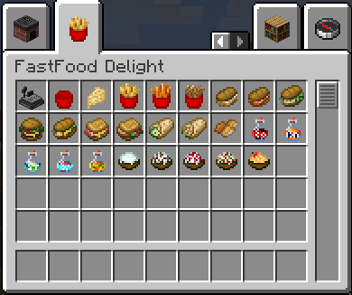
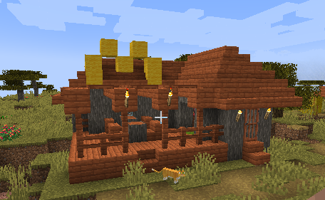

# FastFood Delight: Fabric Port

**An unofficial Minecraft 1.17.1 Fabric port of [FastFood Delight](https://www.curseforge.com/minecraft/mc-mods/fastfood-delight) by Akaneo.**

FastFood Delight: Fabric Port brings the original mod's fast-food menu, waiter villagers, checkout machines, and village fast-food houses to Minecraft 1.17.1 on the Fabric loader. It is an independent community project. It is **not** affiliated with, endorsed by, or supported by the original author, the Farmer's Delight team, or Mojang.

> **Install only one edition.** Faithful Edition and Enhanced Edition use the same mod id (`fastfooddelight_fabric`). If both are installed, the game will not start correctly.

## Project overview

- **Original mod:** FastFood Delight for Minecraft Forge 1.19, by **Akaneo** (CurseForge: `akaneo2`).
  - CurseForge: <https://www.curseforge.com/minecraft/mc-mods/fastfood-delight>
  - GitHub: <https://github.com/akaneoMT/FastFoodDelight>
- **This project:** an unofficial Fabric 1.17.1 port, based on the original `1.19-1.2.1` source. Later upstream versions (1.2.3 / 1.2.4) were not ported.
- **Editions:** Faithful Edition (fidelity-focused) and Enhanced Edition (selected fixes and deliberate additions).
- **License:** MIT for both the original mod and this port. See [LICENSE](LICENSE) and [NOTICE](NOTICE).

The port targets exactly **Minecraft 1.17.1 + Fabric**. It is not a multi-version project, and it does not add a GUI, a checkout transaction system, custom entities, or any content beyond what is listed below.

## Editions

### Faithful Edition — `1.2.1+mc1.17.1`

Faithful Edition aims to preserve the original mod's content, values, and behavior, with only the changes needed to run on Minecraft 1.17.1 / Fabric. Those necessary changes include:

- 1.17.1 data and resource conversions (registry namespace, recipes, tags, models, blockstates, structure files);
- a custom smelting serializer so the original "1 milk bucket → 8 cheese" output is preserved on 1.17.1;
- migration fixes: waiter profession texture, 1.17.1 trade-title key, correct food/drink stack sizes, and per-world village injection;
- a new Simplified Chinese language file (`zh_cn`) in addition to the original `en_us`, `en_gb`, and `fr_fr` (an addition, not a migration requirement).

Original quirks and known bugs are intentionally preserved. See [Known issues](#known-issues-and-changelog).

### Enhanced Edition — `1.3.0+mc1.17.1`

Enhanced Edition is built on the same port and adds the approved fixes and deliberate changes listed below. It is not a different mod: all base content is identical, and the changes are data/asset-level except for the Chicken Wrap food value. Choose it if you prefer a craftable checkout machine, a checkout machine that can also be mined properly in survival, biome-correct village connections, waiters in every village type, and a small amount of extra village loot.

### Differences at a glance

| Area | Faithful Edition | Enhanced Edition |
|---|---|---|
| Checkout machine recipe | No recipe (as in the original) | Craftable: 4 iron ingots, 1 glass, 1 redstone, 3 paper |
| Checkout machine mining | Original behavior preserved (the broken tag is kept) | Correct `minecraft:mineable/pickaxe` tag (pickaxe is the right tool) |
| Non-plains village streets | Original pools (all point to plains streets) | Biome-specific street pools |
| Waiters in non-plains villages | None (leatherworker only) | One waiter added per non-plains house; the leatherworker is kept |
| Apple Sauce cooking | No bowl container (original behavior) | Requires and returns a bowl |
| Chicken Wrap | 10 nutrition / 0.8 saturation, no effect | 11 / 0.8 + Resistance I (15 s) |
| Village chests | Empty (original behavior) | Random FastFood Delight food loot |
| Cheese recipe | Contains an ineffective extra top-level `count` field | Field removed; output is still 8 cheese per milk bucket |
| Languages | `en_us`, `en_gb`, `fr_fr`, `zh_cn` | Same |

The Enhanced Edition contains every item, recipe, trade, and structure from the Faithful Edition plus the changes above. The two editions share the same Java code except for the Chicken Wrap food values.

## Features

### Food and drinks

- **26 registered items:** 24 food/drink items (19 solid foods + 5 drinks), 1 fries-bowl container item, and 1 checkout machine block item.
- **Burgers, sandwiches, and wraps:** Cheeseburger, Chicken Cheese Sandwich, Croque Monsieur, Pork Sandwich, Cod Sandwich, Salmon Sandwich, Rabbit Sandwich, Cheese Wrap, Chicken Wrap.
- **Fried foods:** French Fries, Carrot Fries, Fried Onions, and Chicken Nuggets. Fries and fried onions return a fries bowl when eaten.
- **Drinks:** Cola Soda, Orange Soda, Lemon Soda, Creaming Soda, Iced Tea. They can always be drunk, restore Regeneration I for 15 seconds, return a glass bottle, and stack to 16.
- **Desserts:** Ice Cream, Chocolate Ice Cream, Sweet Berry Ice Cream, Fruit Ice Cream, Apple Sauce. These return a bowl when eaten.
- **Cheese:** an edible ingredient (4 nutrition / 0.4 saturation).
- A dedicated **FastFood Delight creative tab** containing all 26 items.

### Waiter villagers and trades

- A custom villager profession, **`fast_food_waiter`**, which works at the checkout machine.
- **30 trades** across five levels (4 / 10 / 5 / 5 / 6), paid in gold nuggets. Seven of them offer Farmer's Delight foods. As usual for Minecraft trading, each level shows a random subset of its offers in the trading UI.
- Villagers can claim a checkout machine as their job site naturally.

### Village fast-food houses

- **Five structures** (plains, desert, savanna, snowy, taiga) injected into the matching vanilla village house pools at server start (weight 25).
- Each house contains a checkout machine, village-style interior, and a chest.
- In the Enhanced Edition, non-plains houses also contain a waiter, and all five house chests contain random FastFood Delight food.

### Checkout machine

- A horizontal-facing block with a 10-pixel collision shape and iron-block properties.
- It is the waiter's workstation and a decorative machine. Like the original mod, it has **no GUI and no checkout transaction logic**; this port does not add one.

### Farmer's Delight integration

- Four `farmersdelight:cooking` pot recipes: French Fries, Carrot Fries, Fried Onions, and Apple Sauce.
- Farmer's Delight items are used in recipes and in seven waiter trades.
- Requires the **Farmer's Delight [Fabric]** dependency (see below).

### Languages

- `en_us`, `en_gb`, and `fr_fr` from the original mod, plus `zh_cn` added by this project. Both release JARs include all four languages.

## Compatibility and requirements

| Component | Requirement declared in the mod | Version used for development and testing |
|---|---|---|
| Minecraft | **1.17.1** (exact) | 1.17.1 |
| Fabric Loader | `>=0.11.6` | 0.12.12 |
| Fabric API | `>=0.40.1+1.17` | 0.46.1+1.17 |
| Farmer's Delight [Fabric] | `>=0.1.3` (mod id `farmersdelight`) | 0.1.3 |
| Java | 16 or newer (required by Minecraft 1.17.1) | JDK 16 |

Notes:

- The versions above are the verified combination. The JAR metadata declares lower minimums, but **older combinations have not been tested**; use Fabric Loader 0.12.12 and Fabric API 0.46.1+1.17 if possible.
- **Farmer's Delight [Fabric] 0.1.3** is a separate community port based on Farmer's Delight 0.4.3 (Modrinth project `farmers-delight-fabric`, MIT). It is archived and is **not** the official Farmer's Delight. The official Farmer's Delight has no Fabric build, and Farmer's Delight Refabricated for newer Minecraft versions is a different project.
- Client and dedicated server are both supported. The mod does not add a client-only entrypoint.
- No JEI, AppleSkin, or CraftTweaker integration. No compatibility is promised with other mods, other loaders, other Minecraft versions, or existing worlds from the original Forge mod.

## Installation

1. Install **Minecraft 1.17.1** and the **Fabric Loader** (<https://fabricmc.net/use/installer/>).
2. Download **Fabric API** for 1.17.1 (<https://modrinth.com/mod/fabric-api>) and **Farmer's Delight [Fabric] 0.1.3** (<https://modrinth.com/mod/farmers-delight-fabric/version/cRnlUfGm>).
3. Download **one** FastFood Delight: Fabric Port JAR: either Faithful Edition or Enhanced Edition.
4. Put Fabric API, Farmer's Delight [Fabric], and the selected FastFood Delight JAR into the Minecraft `mods` folder.
5. Start the Fabric 1.17.1 profile.

**Do not install both editions.** They share the mod id `fastfooddelight_fabric`; having two copies in `mods` will cause a duplicate-mod error. If you switch editions, remove the old JAR first.

Current release files:

| Edition | JAR file |
|---|---|
| Faithful `1.2.1+mc1.17.1` | `fastfooddelight-fabric-1.17.1-1.2.1-faithful.jar` |
| Enhanced `1.3.0+mc1.17.1` | `fastfooddelight-fabric-1.17.1-1.3.0-enhanced.jar` |

SHA-256 checksums are listed in [CHANGELOG.md](CHANGELOG.md).

## Known issues and changelog

See [CHANGELOG.md](CHANGELOG.md) for the changes in each edition.

Known issues and intentional limitations:

- **The checkout machine has no GUI and no checkout function.** It is a decorative block and the waiter's workstation, exactly as in the original mod.
- **The five drinks have no crafting recipe in either edition.** They can only be obtained from waiter trades.
- **Faithful Edition preserves original quirks**, including: the checkout machine's incorrect mining tag (slow mining / no survival drop); non-plains villages without a waiter; non-plains structures pointing to the plains street pool; Apple Sauce cooking without a bowl; Chicken Wrap at 10/0.8 with no effect; Chicken Nuggets sharing the fries values; and 1 milk bucket producing 8 cheese.
- **Enhanced Edition:** in some non-plains villages, part of the waiter's profession texture may be obscured by the villager's biome clothing. This is a visual issue only and does not affect trading or AI.
- A Farmer's Delight trade item display anomaly (`mixed_salad` shown as `air`) was observed once during testing and could not be reproduced. It remains under observation.
- Some client-side visual checks are still manual (for example, the Chicken Wrap effect icon and detailed street-connection visuals). Server-side behavior for these features has been verified.
- The mod is for **Minecraft 1.17.1 only**. It will not load on 1.18+, 1.19+, or on Forge/NeoForge.

No claim is made that every original bug has been fixed. Enhanced Edition fixes only the listed items; several original behaviors were deliberately left unchanged.

## Credits and licensing

- **Original mod:** FastFood Delight, created by **Akaneo** (CurseForge: `akaneo2`), for Minecraft Forge 1.19.
  - CurseForge: <https://www.curseforge.com/minecraft/mc-mods/fastfood-delight>
  - GitHub: <https://github.com/akaneoMT/FastFoodDelight>
- **Fabric port and modifications:** by **CFood0112**, released under the MIT License.
- **License files:** [LICENSE](LICENSE) contains the MIT license text; [NOTICE](NOTICE) contains the attribution and third-party notices.
- **Attribution:**
  - Original mod: FastFood Delight by Akaneo.
  - Fabric port and modifications: CFood0112.
  - This is an unofficial port and is not affiliated with or endorsed by the original author.

**About the upstream license file:** the original mod declares `license="MIT License"` in its `mods.toml`, and its CurseForge listing was verified as MIT on 2026-10-21. The upstream GitHub repository also contains a stock Forge MDK `LICENSE.txt` (LGPL-2.1 text for Forge/FML, plus MCP and third-party notes). That file belongs to the Forge MDK template, not to the FastFood Delight mod code. This port does not copy or redistribute the MDK, Forge, FML, MCP, Mojang, or Minecraft code. See [NOTICE](NOTICE) for the full explanation.

**Third-party components (all optional or required runtime dependencies, none bundled):**

- **Farmer's Delight** by vectorwing — MIT License.
- **Farmer's Delight [Fabric] 0.1.3** by Zifiv, vectorwing, and StevenPlayzz — MIT License. Required dependency; not included in this project's files.
- **Fabric Loader** and **Fabric API** — Apache License 2.0. Required dependencies; not included.
- **Minecraft** — Mojang/Microsoft. Not included.

Both editions use the same original icon artwork prepared for this project. The CurseForge project avatar is prepared separately and is not a copy of the original project's avatar.

This project is unofficial and is not affiliated with or endorsed by Akaneo, vectorwing, the Farmer's Delight team, Mojang, Microsoft, or the Fabric project.

## Support and bug reports

- Report problems with **this Fabric port** through this repository's GitHub issue tracker.
- Do **not** report Fabric-port bugs to the original FastFood Delight author or to the Farmer's Delight team. Report Farmer's Delight [Fabric] issues to that project's own tracker.
- When reporting a problem, include:
  - edition and version (Faithful `1.2.1+mc1.17.1` or Enhanced `1.3.0+mc1.17.1`);
  - Minecraft version, Fabric Loader version, Fabric API version, and Farmer's Delight [Fabric] version;
  - a list of other installed mods;
  - the full `latest.log` and any crash report;
  - clear steps to reproduce the issue.
- Feature requests and balance suggestions are welcome, but the Faithful Edition will not adopt behavior changes that break fidelity.

## Screenshots

*The FastFood Delight creative tab with all 26 items.*

*A fast-food house generated in a village.*

<!-- Additional screenshots to capture later: waiter villager at the checkout machine, checkout machine close-up, a table of food and drinks, desserts, and an optional Faithful/Enhanced comparison. -->

## Disclaimer

This is an unofficial fan port provided "as is", without warranty of any kind. Minecraft is a trademark of Mojang Synergies AB. FastFood Delight is the work of its original author. Farmer's Delight is the work of vectorwing. All trademarks and copyrights belong to their respective owners.
